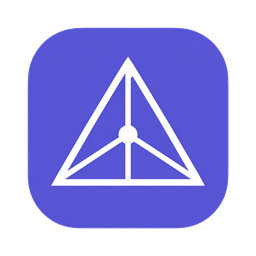
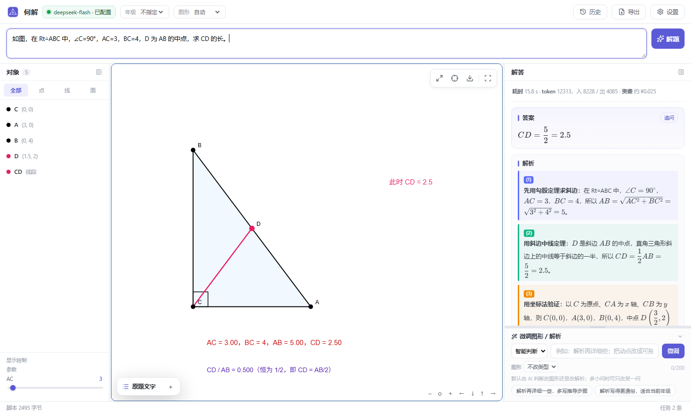
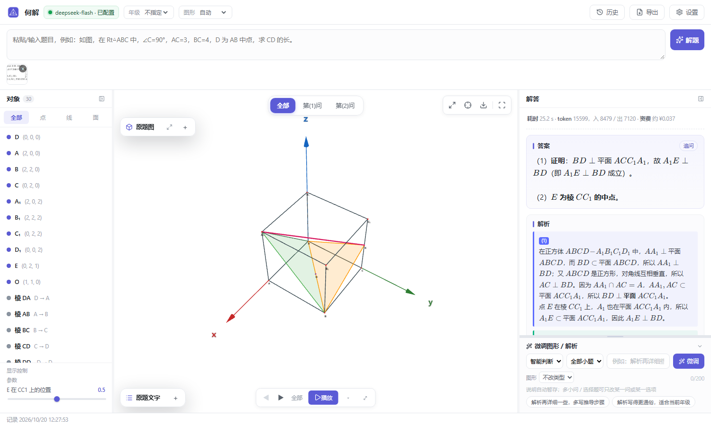
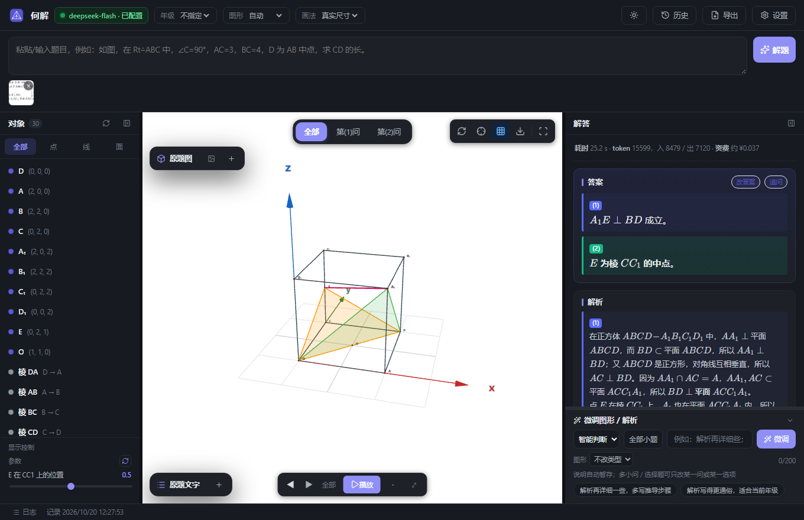
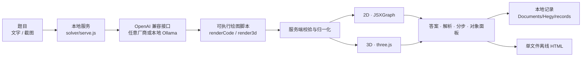

<div align="center">



# 何解 · Hegy

**贴一道几何题，得到一个可以拖动、可以旋转、可以分步看的图形。**

本地运行的 AI 动态几何解题器 · 不注册 · 无遥测 · 免构建

    <a href="https://github.com/kidnappe/hegy/actions/workflows/ci.yml"></a>

<a href="https://kidnappe.github.io/hegy/">发布页</a> · <a href="https://github.com/kidnappe/hegy/releases">下载</a> · <a href="docs/DEVELOPMENT.md">开发文档</a> · <a href="STYLE.md">产品与风格</a> · <a href="CONTRIBUTING.md">参与贡献</a>

</div>



---

## 它和「拍照搜题」不一样

搜题软件给你一张**图片**。何解给你一段**可以执行的图形**——点能拖、视图能缩放、每一步能高亮，因为模型返回的是绘图脚本，不是截图。

| | 常见的截图式解题 | 何解 |
|---|---|---|
| 图形 | 一张位图，看不清就没了 | 矢量图形，拖点、缩放、旋转、复位 |
| 讲解 | 只有最终答案 | 分步播放，每步高亮对应对象 |
| 追问 | 换个说法就重来一遍 | 自然语言微调，可审查后保留或撤销 |
| 数据 | 题目上传到别人的服务器 | 只发给你自己配置的模型接口，记录留在本机 |
| 复用 | 无法二次利用 | 导出单文件 HTML，双击即开、离线可看 |

整套链路——输入、调用模型、校验、渲染、导出——都在本机跑完，没有账号体系，也没有遥测。

---

## 功能

**输入**

| 能力 | 说明 |
|---|---|
| 文字题 | 题目框最多 1000 字，`Ctrl+Enter` 直接提交 |
| 图片题 | 粘贴截图、拖入图片、多图上传；提交前可重新框选题图 |
| 年级 | 不指定 / 初一 … 高三，按对应学段的知识范围作答 |
| 图形类型 | 自动 / 平面 2D / 立体 3D，可交给模型判断，也可强制指定 |
| 画法 | 真实尺寸（坐标即真值）或「像题图」（按教材示意图估比例） |

**解题**

- 异步任务：提交后立即返回，页面不阻塞，最多同时跑 6 个任务。
- 实时进度：SSE 推送阶段文案（调用模型 → 输出中（已接收 N 字）→ 解析 → 校验图形 → 完成），可随时取消。
- 断线兜底：SSE 断了自动回落轮询；刷新页面能恢复未完成的任务。
- 结果校验：服务端校验模型返回的 JSON 与绘图脚本，不合法自动重试；前端渲染失败会让模型按报错自行修正。

**图形**

| 区域 | 能力 |
|---|---|
| 2D 画布 | 拖点、拖对象、滚轮缩放、拖拽平移、方向键微调 |
| 3D 画布 | 拖动旋转、滚轮缩放、坐标轴、平面与立体对象 |
| 对象面板 | 按点 / 线 / 面筛选，实时显示坐标、长度、面积、角度，可单独显隐与定位 |
| 参数区 | 模型声明的开关与滑块，直接驱动图形 |
| 测量卡 | 关键量实时刷新 |
| 网格 | 建系题自动铺坐标纸，2D / 3D 共用开关 |

**讲解与沉淀**

- 答案与解析：KaTeX 渲染，多小问切换，一键定位到图上对象。
- 步骤条：`◀ ▶` 分步播放，说明支持公式。
- 微调：改图形 / 改解析 / 逐问微调，可先审查再保留。
- 历史记录：一条记录一个本地 JSON，可回看、导入、导出。
- 导出：单文件离线 HTML（内嵌图形引擎、公式字体、答案与解析）或当前视图 PNG。

**外观**

三套皮肤 × 日间 / 夜间，桌面与手机共用同一份界面代码。

| 皮肤 | 气质 |
|---|---|
| 原色 | 冷灰纸面 + 紫色主色，默认 |
| 暖工业 | 暖灰材质、衬线标题，长时间阅读更舒服 |
| 瑞士网格 | 黑白栅格、黑描边，极简 |

<p align="center">
  
  
</p>

<p align="center"><sub>左：3D 立体几何，拖动旋转、多小问切换　·　右：夜间模式，画布保持白纸，界面转深</sub></p>

---

## 下载

不装环境也能用，直接取安装包：

| 平台 | 文件 | 体积 | 说明 |
|---|---|---|---|
| Windows x64 | [`hegy-1.2.2-setup-x64.exe`](https://github.com/kidnappe/hegy/releases/latest) | 65 MB | 安装版，带开始菜单与卸载项 |
| Windows x64 | [`hegy-1.2.2-portable-x64.exe`](https://github.com/kidnappe/hegy/releases/latest) | 91 MB | 便携版，双击即用；用户数据放在 exe 同目录 `HegyData/` |
| Android 7.0+ | [`hegy-1.2.1-android-release.apk`](https://github.com/kidnappe/hegy/releases/tag/mobile-v1.2.1) | 4.8 MB | 正式签名，侧载安装 |

每次发布都附带 `SHA256SUMS.txt`，下载后可自行校验。所有版本见 [Releases](https://github.com/kidnappe/hegy/releases)；想看界面和更新说明，去[发布页](https://kidnappe.github.io/hegy/)。

<p align="center">
  
</p>

<p align="center"><sub>手机端：拍一张、粘一段，三步拿到动态图与解析</sub></p>

---

## 快速开始

### 环境

- **Node.js 18+**（开发时用 v22 验证）
- 一个 OpenAI 兼容的模型服务：DeepSeek、OpenAI、通义、智谱、Kimi、Groq、OpenRouter、Gemini，或者本机 Ollama
- 可选：Edge / Chrome（测试与截图脚本使用）

不需要 `npm install`，根目录也没有构建步骤——改完 `solver/*.js` 刷新页面就生效。

### 跑起来

```bash
git clone https://github.com/kidnappe/hegy.git
cd hegy

node solver/serve.js 8099     # 等价于 npm start
```

打开 <http://127.0.0.1:8099/>，服务会自动跳到 `solver/index.html`。第一次进来右上角显示「未配置模型」，点它按向导填三步：**服务商 → API Key → 模型**。

### 端口

| 用途 | 端口 |
|---|---|
| 浏览器开发 | `8099` |
| Mock 模型服务 | `8098` |
| 桌面版内建服务 | `17321` |

### 不花 token 调界面

```bash
node solver/mock.js           # 另开一个终端
```

在设置里填 Base URL `http://127.0.0.1:8098/v1`、API Key 与模型名都填 `mock`。Mock 会按题目关键词返回固定的 2D / 3D 场景，适合调 UI、跑测试。

---

## 配置模型

只要求接口兼容 OpenAI 的 `POST /chat/completions`，不绑定厂商。设置里的预设会连接口地址、默认模型和申请 Key 的控制台一起填好：

| 预设 | Base URL |
|---|---|
| DeepSeek | `https://api.deepseek.com/v1` |
| OpenAI | `https://api.openai.com/v1` |
| 通义千问 | `https://dashscope.aliyuncs.com/compatible-mode/v1` |
| 智谱 GLM | `https://open.bigmodel.cn/api/paas/v4` |
| Kimi | `https://api.moonshot.cn/v1` |
| Groq / OpenRouter / Gemini | 内置，选完即填 |
| Ollama 本地 | `http://127.0.0.1:11434/v1` |
| 自定义 | 任意兼容端点 |

温度默认 `0.2`，模型名可以手填，也可以点「获取列表」从接口拉取。配置保存到 `~/.hegy/settings.json`，**不写进仓库**；`solver/config.json`、`.env`、`*.local.json` 都已被忽略。

---

## 工作原理



三条不能动的约定：

1. **模型返回的是脚本，不是图片。** 图形能拖、能缩放、能分步高亮，全靠这一点。
2. **`GGBBoard` / `GGBMath` 是历史契约。** 提示词里的这两个全局名不能改名，`shim.js` 负责把它们映射到 JSXGraph 和自研的 `geometry.js`。
3. **服务端只放行白名单字段。** 新增字段要同时改 `serve.js` 的归一化逻辑，否则前端拿不到。

更细的请求链路、调试手法和踩坑记录见 [`docs/DEVELOPMENT.md`](docs/DEVELOPMENT.md)。

---

## 项目结构

```text
solver/                 应用本体：浏览器界面 + 本地 Node 服务
  index.html            页面骨架（大量旧 ID 是兼容契约，勿随意改名）
  serve.js              静态文件 + /api/* + SSE + 记录落盘
  solver.js             解题流程、渲染、导出、历史、微调
  ui.js / ui.css        界面布局、对象面板、步骤条、设置
  skins.js / skins.css  皮肤运行时：三套皮肤 × 日夜
  geometry.js           自研几何计算库（window.HexMath）
  shim.js               兼容层：GGBBoard → JSXGraph，GGBMath → HexMath
  prompt.txt            系统提示词（绘图 DSL 规范）
  vendor/               JSXGraph / KaTeX / Lucide
  vendor3d/             three.js / OrbitControls / 3D 渲染内核

desktop/                Electron 外壳与 electron-builder 配置
mobile/                 Android 壳（Capacitor）：src/ 手机界面 + android/ 工程
release-page/           发布页（GitHub Pages 静态站）
docs/                   开发文档、发布流程、截图
tools/                  Windows + Edge 的测试 / 截图脚本
```

---

## 数据与隐私

- **没有账号，没有遥测。** 应用只向你配置的那个模型服务发送题目文本与图片。
- API Key 存在本机用户目录，不写进项目文件。
- 解题记录默认在 `Documents/Hegy/records/`，一条记录一个 JSON。
- 错误日志在 `~/.hegy/logs/errors.jsonl`（最近 300 条在内存里，可在状态栏「日志」里看）。
- 导出的 HTML 是单文件离线文件，不依赖何解服务；里面的内容任何拿到文件的人都能看，分享前请自己过一遍。
- 提 Issue 前请删掉 API Key、完整记录和题图里的个人信息。

---

## 开发与测试

```bash
npm test          # 基础自检：文件完整性 + JS 语法 + 渲染/导出契约
```

`tools/verify.js` 不启动服务、不访问模型，提交前跑一遍就够，CI 也是跑它（Node 18 / 20 / 22 三档）。

完整的浏览器回归脚本在 `tools/`，依赖 Windows + Edge + CDP，部分脚本用固定端口和本地路径，跑之前先读 [`tools/README.md`](tools/README.md)。

打包：

```bash
cd desktop
npm install
npm start          # 开发态启动 Electron
npm run dist       # Windows x64 安装版 + 便携版
npm run dist:arm64 # Windows ARM64
```

产物在 `desktop/dist/`（已忽略）。手机端构建流程见 [`mobile/ARCH.md`](mobile/ARCH.md)，发布流程见 [`docs/RELEASING.md`](docs/RELEASING.md)。

开发约定：

- 原生 JS，不引框架、不加构建步骤；
- 新代码保持现有风格（IIFE / `var` / 2 空格 / UTF-8）；
- 改提示词或绘图 DSL，必须同步更新 `solver/prompt-rules.md` 与相关测试；
- 不提交 `node_modules/`、`dist/`、`solver/config.json`、记录文件与导出物。

---

## 常见问题

<details>
<summary><b>只能在 Windows 上用吗？</b></summary>

本体是一个网页 + 一个 Node 服务，任何能跑 Node 18+ 的系统都能 `node solver/serve.js` 打开。目前只有桌面外壳和打包脚本是面向 Windows 的，macOS / Linux 需要自己调 `desktop/package.json` 的 `build` 段。
</details>

<details>
<summary><b>要花钱吗？</b></summary>

应用本身免费（AGPL-3.0）。模型调用按你选的厂商计费——想零成本就用本机 Ollama，或者在设置里把模型指向 `solver/mock.js` 调界面。
</details>

<details>
<summary><b>图形画错了怎么办？</b></summary>

三种办法，从轻到重：拖动图形手动摆正；用「微调」写一句话让它改（可先审查再保留）；或者手填正确答案 / 粘一张答案截图，让它「按此答案重画」。
</details>

<details>
<summary><b>手机端和电脑端的数据互通吗？</b></summary>

不互通，也不做云同步——两端各自存在本机。记录是普通 JSON 文件，需要时可以手动拷走或用「导入」搬过去。
</details>

<details>
<summary><b>为什么答案和图形偶尔不对？</b></summary>

模型会算错，也会画错。何解能校验语法和结构，但校验不了数学正确性——请把它当辅助工具，而不是标准答案。
</details>

---

## 已知限制

- AI 生成的答案与图形都可能出错，重要结论请自行复核。
- 桌面打包面向 Windows x64 / ARM64；macOS / Linux 未配置。
- 测试与截图脚本以 Windows + Edge 为主，跨平台支持还不完整。
- 手机端是非流式请求，长题推理期间只有阶段提示，没有逐字输出。
- 安装版约 65 MB、便携版约 91 MB（Electron 26.6），体积随 Electron 版本变化。

---

## 参与贡献

欢迎 Issue 和 PR。动手前请读 [`CONTRIBUTING.md`](CONTRIBUTING.md)、[`CODE_OF_CONDUCT.md`](CODE_OF_CONDUCT.md)、[`SECURITY.md`](SECURITY.md)。

1. 一个 PR 只做一件事；
2. 说清改动动机、验证方式与影响范围；
3. 涉及界面的改动附上截图；
4. 不提交密钥、用户记录、构建产物和大体积素材。

---

## 许可证

Copyright (C) 2026 zhouxuan and Hegy contributors.

本项目以 **[GNU AGPL-3.0-only](LICENSE)** 授权发布：可以自由使用、修改、分发，包括商业使用；分发修改版时要保留版权声明并以同一许可证授权；**如果你改了它并作为网络服务提供给他人，必须向这些用户提供对应的完整源码**（AGPL 第 13 条）。只是在自己电脑上用，通常不产生额外义务。

第三方组件各按其自身许可证授权（见下表与 [`solver/vendor/LICENSES.md`](solver/vendor/LICENSES.md)），不受本项目许可证影响。提交 PR 即表示同意以 AGPL-3.0 授权你的贡献。

---

## 第三方组件

| 组件 | 版本 | 许可证 |
|---|---|---|
| [JSXGraph](https://jsxgraph.org/) | 1.12.2 | LGPL-3.0 或 MIT（本项目按 MIT 使用） |
| [KaTeX](https://katex.org/) | 0.19.0 | MIT |
| [three.js](https://threejs.org/) | r127 | MIT |
| [OrbitControls](https://threejs.org/) | r127 | MIT |
| [Lucide](https://lucide.dev/) | 1.59.0 | ISC |

完整版权与许可说明见 [`solver/vendor/LICENSES.md`](solver/vendor/LICENSES.md)。分发时请保留第三方文件头部的版权声明。

---

<div align="center">
<sub>何解 · Hegy — 把几何题变成可以动手玩的图形。</sub>
</div>
